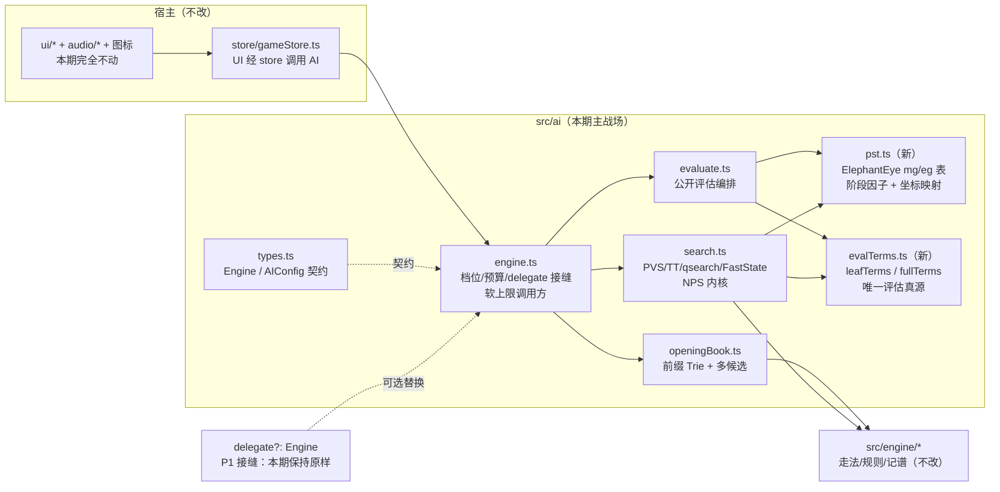
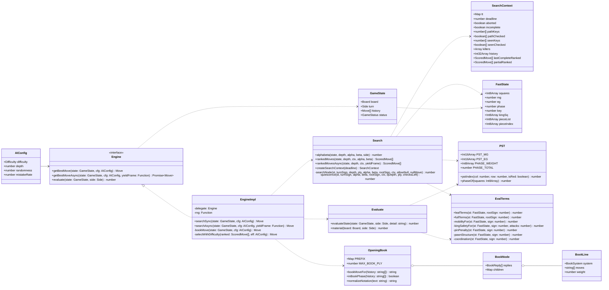
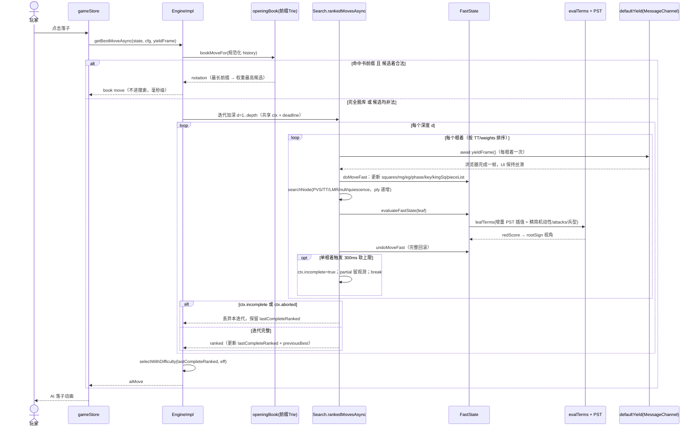
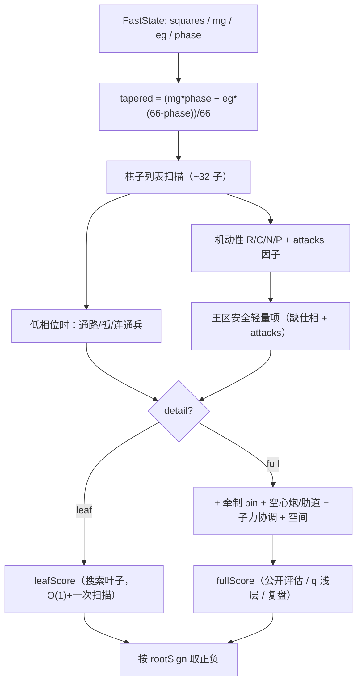
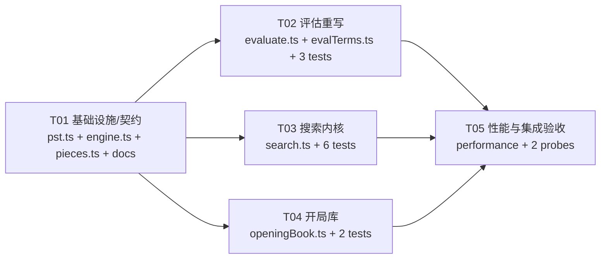

# 中国象棋引擎 · 棋力架构级增强方案与任务分解

> **版本**：`v2026.11.19.1`（日期 + 当日第 1 次更改）；Android `versionCode` 14 → 15
> **文档作者**：架构师 高见远（Gao）
> **项目根目录**：`/Users/mac/WorkBuddy/2026-07-23-13-23-58/xiangqi-trainer/`
> **任务性质**：设计文档（不写实现代码）。工程师按本文实现，QA 按第 10、11 节验收。
> **硬约束**：`file://` Android WebView；无 ES module import、无 Worker、无 CDN、无外部图片；所有 JS 内联随包；异步分片用 MessageChannel yield（`engine.ts` 已有 `defaultYield`）；图标不动；TypeScript strict。好友对战暂缓（本期不做）。

---

## 0. 结论摘要（给主理人）

1. **病根不是搜索框架，而是"评估没有棋感 + 开局库一碰就脱 + 将死分方向反了"**。搜索的极大极小/PVS/TT/Zobrist/LMR/quiescence/null-move 均正确，不要重写框架。
2. **本期采用公开强引擎数值**：ElephantEye（象眼 3.3，LGPL-2.1）的 12 张 256 项子力位置表 + 阶段插值公式，配合 Fairy-Stockfish 的 tapered mg/eg 结构。这是本次"架构级"的核心，而不是再调参数。
3. **纯 JS 主线程的诚实定位**：可稳定达到 **较强业余 / 中级偏上**（规范开局 15 步、1~2 步战术可靠、不再走出窝心马与冒进炮），**不能保证达到"稳定高于普通业余的高手水平"**。要达到后者需 d12+ 或 NNUE/WASM，见 §1.7。
4. **任务 5 个、零新增依赖**。T01 基础设施/共享契约 → T02 评估、T03 搜索、T04 开局库（三者仅依赖 T01，可并行）→ T05 性能与集成验收。
5. **验收基线（已实测，见 §10）**：开局前 12 步仅 7 步命中；脱库后走「马三退五」「砲八进一」；d6=147877 节点/1266ms（≈117k nps），d8 被软上限标记 incomplete；战术题 4/5（唯一失败 `end-1` 正是一步杀误判，与将死分反转直接相关）。

---

## Part A：系统设计

### 1. 实现方案与框架选型

#### 1.1 诊断病根 → 方案逐条映射

| # | 实证病根 | 架构级方案 | 任务 | 可验证指标 |
|---|----------|-----------|------|-----------|
| 1 | `bookMoveFor` 用 `entry.line.length === normal.length` 精确匹配（`openingBook.ts:83`），人类走一着书外正常棋（车九进一）即脱库；书仅 7~8 步；同前缀多条 line 死代码（取第一个匹配） | 前缀 Trie + **最长前缀匹配** + 多候选按权重；按主领域名组织 5 大体系 × 15~20 步；保留"书是建议、合法性由调用方校验"语义 | T04 | 前 15 步命中率 ≥ 90%；书外一着仍命中 |
| 2 | 评估只有 material + PST + 极简 mobility + 数仕相的 kingSafety；**分不出好坏棋**（卒七进一 5 分 vs 砲八进四 13 分，相对几千分是噪声） | ElephantEye 公开 PST + tapered 插值 + 6 类补充项（王安全/牵制/全子机动性/兵型/协调/空间），分层计算 | T01、T02 | 两着分差 ≥ 30 且合理着进 top-3 |
| 2b | `evaluate.ts:166-197` `fastMobility` 数**所有**棋子相邻空格；`search.ts:610` 只数车/炮 —— 两套评估不一致 | 单一真源 `evalTerms.ts`；`evaluateState` 与 `evaluateFastState` 调用同一函数 | T02 | 一致性单测 |
| 3 | 纯 JS ≈117k~128k nps；3500ms 实际 d7（d8 incomplete） | 增量 Zobrist、kingSq 缓存、棋子列表、去分配、扁平 offset 表、可选类型化 TT | T03、T05 | ≥250k nps、有效 d9+ |
| 4 | 将死分用剩余深度 `MATE_SCORE - depth`（`search.ts:991`/`:485`），**越早杀分越低**：实测一步杀 d1=999994 < 两步杀 d2=999999 | 改为 `MATE_SCORE - ply`（ply = 距根步数），quiescence 同步 | T03 | 一步杀 > 两步杀；`end-1` 通过 |
| 5 | quiescence 只搜吃子（`:488`），将军开始的强制杀漏算 | 首 1~2 个 q 层加入安静将军着，每点 ≤4、每线 ≤2 次 | T03 | 强制杀战术题 |
| 6 | 软上限触发后把**部分根着列表当完整结果**覆盖上一迭代（`search.ts:1323-1338`） | 一律 `ctx.incomplete = true`；partial 只留观测，不覆盖 `lastCompleteRanked` | T01（调用方）、T03（内核） | 软上限单测 |
| 7 | null-move 只翻 turnSign 不动棋盘，可能与 `seenKeys/pathKeys` 误判重复 | null 子节点跳过重复判定且不入 pathKeys | T03 | 重复检测回归 |
| 8 | `search.test.ts` 3 例、`evaluate.test.ts` 5 例，高级特性无回归 | 新增 8 组测试 + 2 个探针脚本 | 全任务 | 见 §11 |

#### 1.2 总体模块关系（改动范围一目了然）



**契约边界**：`Engine` 接口（`getBestMove` / `getBestMoveAsync?` / `evaluate`）签名**不变**，store 与 UI 零改动。`delegate` 接缝保持原样（T01 只确保其在新逻辑前仍然优先短路），本期不新增接口文件。

#### 1.3 【A】评估函数重设计（最高优先级）

##### 1.3.1 数值来源与落地决策

| 来源 | 具体位置 | 取用什么 | 授权/风险处置 |
|------|---------|---------|--------------|
| **ElephantEye（象眼 3.3）** | `https://github.com/QiuleiWang/eleeye` → `eleeye/preeval.cpp`（LGPL-2.1） | 12 张 `uint8_t[256]` 位置表（帅兵/马/车/炮 × 中局/残局，仕相 × 受威胁/无威胁/无威胁升变），3 张 `[16]` 威胁表，`ROOK_MIDGAME_VALUE=6 / KNIGHT_CANNON=3 / OTHER=1 / TOTAL=66` 阶段权重，以及插值式 `(T_mg·phase + T_eg·(TOTAL−phase))/TOTAL` | **只取数值事实并署名**，不复制其 C++ 控制流。数值本身不受表达性版权保护；仍在 `pst.ts` 文件头注明出处与 LGPL 提示。若法务要求更保守，启用 §1.3.5 末尾的自洽公式兜底表 |
| **Fairy-Stockfish** | `https://github.com/fairy-stockfish/Fairy-Stockfish` → `src/psqt.cpp`（GPLv3） | 仅架构参考：`make_score(mg, eg)` 双阶段表、逐子种生成、黑方取负镜像。"不照搬代码" | 不复制任何源码/权重 |

**为什么这套数值能治本**：象眼的表正是为"开局/中局/残局"设计的——马在中局中心格值 90~108（边线 85~88），车在中局中心/过河值 206~233（残局回落到 180~190），兵过河后从 ~30 跃升到 85~100，炮残局普遍抬到 100~106，帅在九宫中心 15 且离开底线骤降。当前引擎的 PST 是一套"通用公式"，无法表达这些阶段差异；换成公开表后，"卒七进一"与"砲八进四"的差别会自然变成几十个单位的真实差距。

##### 1.3.2 坐标映射（EE 16×16 → 本项目 9×10）

象眼内部用 16×16 补边棋盘，`sq = 行*16 + 列`；有效区为行 3..12、列 3..11。本项目坐标 `col 0..8`（左→右）、`row 0..9`（0=红底线）。**红视角映射**：

```
eeRow = 12 - row          // 本项目 row 0（红底线）→ EE 行 12；row 9 → EE 行 3
eeCol = col + 3           // 本项目 col 4（中路）→ EE 列 7
eeSq  = eeRow * 16 + eeCol
```

验证：红帅 `(4,0)` → EE 行 12 列 7 = `cucvlKingPawnMidgameAttacking[12*16+7] = 15`（九宫中心最大值）；红兵 `(4,3)` → EE 行 9 列 7 = 15（未过河起点）；红兵 `(4,7)` → EE 行 5 列 7 = 74~100（过河后大幅增值）。方向正确。

**黑子处理**：先把黑子归一化到红视角 `(col,row) → (8-col, 9-row)`，再查同一张表并取负。这样 `f(board) = -f(mirror(board))` 由构造保证（象眼源码自己也用 `SQUARE_FLIP` + 取负实现同一性质）。

##### 1.3.3 阶段因子与 tapered 插值

```
phaseWeight = { K:0, A:1, B:1, N:3, C:3, R:6, P:1 }   // 与象眼一致
PHASE_TOTAL = 6*4 + 3*8 + 1*18 = 66                     // 初始满子 = 66
phase(st) = Σ phaseWeight[piece]        // 双方合计，随吃子单调下降到 0

PST_MG[code][sq] = PIECE_VALUE[type] + mgTable[type][eeSq]   // 红为正
PST_EG[code][sq] = PIECE_VALUE[type] + egTable[type][eeSq]
score_red = Σ ( PST_MG[p] * phase + PST_EG[p] * (66 - phase) ) / 66
```

- 采用 **Stockfish 式单调插值**（phase=66 → 纯中局表；phase=0 → 纯残局表），而不是象眼的钟形 `n*(2T−n)/T`。理由：象眼的钟形因子是为"攻击态势"设计的，我们把它拆到 §1.3.5 的 `attacks` 因子里，语义更清晰、也不会在开局把中局特征打满。
- **`PIECE_VALUE` 统一改用象眼刻度**：`R=900, C=400, N=400, B=200, A=200, P=100, K=10000`（`src/engine/pieces.ts`）。MVV-LVA 相对顺序不变（车 > 炮=马 > 仕相 > 兵，比原先"炮>马"更贴近象棋常识）；`MATE_THRESHOLD = 999000` 仍远高于任何子力总和（≤约 9400），安全。
- **阶段差异说明**：兵过河后 EG 表达到 ~100（开局表 ~15）→ 残局兵是进攻主力；车 MG 中心达 233、EG 回到 ~180~190 → 中局车的调动价值高、残局简化；马 MG 中心 ~108、EG 扁平均匀 ±4 → 中局占位决定马的强弱；炮 EG 全盘抬到 100~106 → 残局炮价值上升；帅 EG 表中心保持高、 MG 表离开底线骤降 → 残局御驾亲征。
- **O(1) 落地**：`FastState` 从 `{squares, mg}` 扩为 `{squares, mg, eg, phase, key, kingSq, pieceList, pieceIndex}`。`doMoveFast/undoMoveFast` 对 `mg / eg / phase / key / kingSq` 做增量更新；叶子只做一次除法 `(mg*phase + eg*(66-phase))/66`，**零 90 格扫描**。

##### 1.3.4 公开 PST 原始数值（供 `pst.ts` 直接抄录）

> 每行 16 项对应 EE 行 `3..12`；行 `0..2` 与 `13..15` 全为 0（下表省略）。每行中第 4~12 项（下标 3..11）对应本项目 `col 0..8`。

```text
cucvlKingPawnMidgameAttacking
 0,0,0,  9, 9, 9,11,13,11, 9, 9, 9, 0,0,0,0
 0,0,0, 39,49,69,84,89,84,69,49,39, 0,0,0,0
 0,0,0, 39,49,64,74,74,74,64,49,39, 0,0,0,0
 0,0,0, 39,46,54,59,61,59,54,46,39, 0,0,0,0
 0,0,0, 29,37,41,54,59,54,41,37,29, 0,0,0,0
 0,0,0,  7, 0,13, 0,16, 0,13, 0, 7, 0,0,0,0
 0,0,0,  7, 0, 7, 0,15, 0, 7, 0, 7, 0,0,0,0
 0,0,0,  0, 0, 0, 1, 1, 1, 0, 0, 0, 0,0,0,0
 0,0,0,  0, 0, 0, 2, 2, 2, 0, 0, 0, 0,0,0,0
 0,0,0,  0, 0, 0,11,15,11, 0, 0, 0, 0,0,0,0

cucvlKingPawnMidgameAttackless
 0,0,0,  9, 9, 9,11,13,11, 9, 9, 9, 0,0,0,0
 0,0,0, 19,24,34,42,44,42,34,24,19, 0,0,0,0
 0,0,0, 19,24,32,37,37,37,32,24,19, 0,0,0,0
 0,0,0, 19,23,27,29,30,29,27,23,19, 0,0,0,0
 0,0,0, 14,18,20,27,29,27,20,18,14, 0,0,0,0
 0,0,0,  7, 0,13, 0,16, 0,13, 0, 7, 0,0,0,0
 0,0,0,  7, 0, 7, 0,15, 0, 7, 0, 7, 0,0,0,0
 0,0,0,  0, 0, 0, 1, 1, 1, 0, 0, 0, 0,0,0,0
 0,0,0,  0, 0, 0, 2, 2, 2, 0, 0, 0, 0,0,0,0
 0,0,0,  0, 0, 0,11,15,11, 0, 0, 0, 0,0,0,0

cucvlKingPawnEndgameAttacking
 0,0,0, 10,10,10,15,15,15,10,10,10, 0,0,0,0
 0,0,0, 50,55,60,85,100,85,60,55,50, 0,0,0,0
 0,0,0, 65,70,70,75,75,75,70,70,65, 0,0,0,0
 0,0,0, 75,80,80,80,80,80,80,80,75, 0,0,0,0
 0,0,0, 70,70,65,70,70,70,65,70,70, 0,0,0,0
 0,0,0, 45, 0,40,45,45,45,40, 0,45, 0,0,0,0
 0,0,0, 40, 0,35,40,40,40,35, 0,40, 0,0,0,0
 0,0,0,  0, 0, 5, 5,15, 5, 5, 0, 0, 0,0,0,0
 0,0,0,  0, 0, 3, 3,13, 3, 3, 0, 0, 0,0,0,0
 0,0,0,  0, 0, 1, 1,11, 1, 1, 0, 0, 0,0,0,0

cucvlKingPawnEndgameAttackless
 0,0,0, 10,10,10,15,15,15,10,10,10, 0,0,0,0
 0,0,0, 10,15,20,45,60,45,20,15,10, 0,0,0,0
 0,0,0, 25,30,30,35,35,35,30,30,25, 0,0,0,0
 0,0,0, 35,40,40,45,45,45,40,40,35, 0,0,0,0
 0,0,0, 25,30,30,35,35,35,30,30,25, 0,0,0,0
 0,0,0, 25, 0,25,25,25,25,25, 0,25, 0,0,0,0
 0,0,0, 20, 0,20,20,20,20,20, 0,20, 0,0,0,0
 0,0,0,  0, 0, 5, 5,13, 5, 5, 0, 0, 0,0,0,0
 0,0,0,  0, 0, 3, 3,12, 3, 3, 0, 0, 0,0,0,0
 0,0,0,  0, 0, 1, 1,11, 1, 1, 0, 0, 0,0,0,0

cucvlKnightMidgame
 0,0,0, 90, 90, 90, 96, 90, 96, 90, 90, 90, 0,0,0,0
 0,0,0, 90, 96,103, 97, 94, 97,103, 96, 90, 0,0,0,0
 0,0,0, 92, 98, 99,103, 99,103, 99, 98, 92, 0,0,0,0
 0,0,0, 93,108,100,107,100,107,100,108, 93, 0,0,0,0
 0,0,0, 90,100, 99,103,104,103, 99,100, 90, 0,0,0,0
 0,0,0, 90, 98,101,102,103,102,101, 98, 90, 0,0,0,0
 0,0,0, 92, 94, 98, 95, 98, 95, 98, 94, 92, 0,0,0,0
 0,0,0, 93, 92, 94, 95, 92, 95, 94, 92, 93, 0,0,0,0
 0,0,0, 85, 90, 92, 93, 78, 93, 92, 90, 85, 0,0,0,0
 0,0,0, 88, 85, 90, 88, 90, 88, 90, 85, 88, 0,0,0,0

cucvlKnightEndgame
 0,0,0, 92, 94, 96, 96, 96, 96, 96, 94, 92, 0,0,0,0
 0,0,0, 94, 96, 98, 98, 98, 98, 98, 96, 94, 0,0,0,0
 0,0,0, 96, 98,100,100,100,100,100, 98, 96, 0,0,0,0
 0,0,0, 96, 98,100,100,100,100,100, 98, 96, 0,0,0,0
 0,0,0, 96, 98,100,100,100,100,100, 98, 96, 0,0,0,0
 0,0,0, 94, 96, 98, 98, 98, 98, 98, 96, 94, 0,0,0,0
 0,0,0, 94, 96, 98, 98, 98, 98, 98, 96, 94, 0,0,0,0
 0,0,0, 92, 94, 96, 96, 96, 96, 96, 94, 92, 0,0,0,0
 0,0,0, 90, 92, 94, 92, 92, 92, 94, 92, 90, 0,0,0,0
 0,0,0, 88, 90, 92, 90, 90, 90, 92, 90, 88, 0,0,0,0

cucvlRookMidgame
 0,0,0,206,208,207,213,214,213,207,208,206, 0,0,0,0
 0,0,0,206,212,209,216,233,216,209,212,206, 0,0,0,0
 0,0,0,206,208,207,214,216,214,207,208,206, 0,0,0,0
 0,0,0,206,213,213,216,216,216,213,213,206, 0,0,0,0
 0,0,0,208,211,211,214,215,214,211,211,208, 0,0,0,0
 0,0,0,208,212,212,214,215,214,212,212,208, 0,0,0,0
 0,0,0,204,209,204,212,214,212,204,209,204, 0,0,0,0
 0,0,0,198,208,204,212,212,212,204,208,198, 0,0,0,0
 0,0,0,200,208,206,212,200,212,206,208,200, 0,0,0,0
 0,0,0,194,206,204,212,200,212,204,206,194, 0,0,0,0

cucvlRookEndgame
 0,0,0,182,182,182,184,186,184,182,182,182, 0,0,0,0
 0,0,0,184,184,184,186,190,186,184,184,184, 0,0,0,0
 0,0,0,182,182,182,184,186,184,182,182,182, 0,0,0,0
 0,0,0,180,180,180,182,184,182,180,180,180, 0,0,0,0
 0,0,0,180,180,180,182,184,182,180,180,180, 0,0,0,0
 0,0,0,180,180,180,182,184,182,180,180,180, 0,0,0,0
 0,0,0,180,180,180,182,184,182,180,180,180, 0,0,0,0
 0,0,0,180,180,180,182,184,182,180,180,180, 0,0,0,0
 0,0,0,180,180,180,182,184,182,180,180,180, 0,0,0,0
 0,0,0,180,180,180,182,184,182,180,180,180, 0,0,0,0

cucvlCannonMidgame
 0,0,0,100,100, 96, 91, 90, 91, 96,100,100, 0,0,0,0
 0,0,0, 98, 98, 96, 92, 89, 92, 96, 98, 98, 0,0,0,0
 0,0,0, 97, 97, 96, 91, 92, 91, 96, 97, 97, 0,0,0,0
 0,0,0, 96, 99, 99, 98,100, 98, 99, 99, 96, 0,0,0,0
 0,0,0, 96, 96, 96, 96,100, 96, 96, 96, 96, 0,0,0,0
 0,0,0, 95, 96, 99, 96,100, 96, 99, 96, 95, 0,0,0,0
 0,0,0, 96, 96, 96, 96, 96, 96, 96, 96, 96, 0,0,0,0
 0,0,0, 97, 96,100, 99,101, 99,100, 96, 97, 0,0,0,0
 0,0,0, 96, 97, 98, 98, 98, 98, 98, 97, 96, 0,0,0,0
 0,0,0, 96, 96, 97, 99, 99, 99, 97, 96, 96, 0,0,0,0

cucvlCannonEndgame
 0,0,0,100,100,100,100,100,100,100,100,100, 0,0,0,0
 0,0,0,100,100,100,100,100,100,100,100,100, 0,0,0,0
 0,0,0,100,100,100,100,100,100,100,100,100, 0,0,0,0
 0,0,0,100,100,100,102,104,102,100,100,100, 0,0,0,0
 0,0,0,100,100,100,102,104,102,100,100,100, 0,0,0,0
 0,0,0,100,100,100,102,104,102,100,100,100, 0,0,0,0
 0,0,0,100,100,100,102,104,102,100,100,100, 0,0,0,0
 0,0,0,100,100,100,102,104,102,100,100,100, 0,0,0,0
 0,0,0,100,100,100,104,106,104,100,100,100, 0,0,0,0
 0,0,0,100,100,100,104,106,104,100,100,100, 0,0,0,0
```

**仕/相表（稀疏，只列非零；`eeSq` 下标）**：

| 表名 | 非零项 |
|------|--------|
| `cucvlAdvisorBishopThreatless` | 行8: 列5/9=20；行10: 列3=18,6=20,7=23,8=20,11=18；行11: 列7=23；行12: 列5/6/8/9=20 |
| `cucvlAdvisorBishopPromotionThreatless` | 同上，数值改为 30 / 28,30,33,30,28 / 33 / 30 |
| `cucvlAdvisorBishopThreatened` | 同上，数值改为 40 / 38,40,43,40,38 / 43 / 40 |

**威胁表（按 EE 列 0..15 索引）**：

```text
cvlHollowThreat  = [0,0,0,0,0,0,60,65,70,75,80,80,80,0,0,0]   // 空心炮
cvlCentralThreat = [0,0,0,0,0,0,50,45,40,35,30,30,30,0,0,0]   // 中路威胁
cvlBottomThreat  = [0,0,0,40,30,0,0,0,0,0,30,40,0,0,0,0]     // 底线威胁
```

> **实施细节**：帅/兵用 `Attacking` 表作为 MG、`Attackless` 表作为 EG 的基础（如 `pst.ts` 中定义 `KING_PAWN_MG = Attacking`、`KING_PAWN_EG = Attackless`），另在 `evalTerms.fullTerms` 中用动态 `attacks` 因子在两表间二次插值（见下表"王区安全"）。仕/相用 `Threatless` 作 MG、`Threatened` 作 EG 近似，并在 `attacks` 高时向 `Threatened` 靠拢。这样 12 张表全部有落点，不浪费公开数据。

##### 1.3.5 补充项：算法、复杂度、计算层级

| 项 | 可实现算法 | 复杂度 | 触发层 | 反对称保证 |
|----|-----------|--------|--------|-----------|
| **王区安全** | ① 缺仕相：PST 已含 A/B 基础值；动态 `leakage = 80 * attacks / 8`，`attacks` = 敌方过河马/车各 2 分、炮/兵各 1 分，加大子净胜×2，上限 8；② 空心炮：敌炮与王同列且中间恰好 1 子、王前无仕 → `+cvlHollowThreat[file]`（60~80）；③ 肋道/中路：敌车在 3/5 列或同列无阻挡 → `+cvlCentralThreat`/`cvlBottomThreat`；④ 九宫被攻击格数（仅 full） | ① O(1) 由扫描得到 attacks；②③ 在主扫描内 O(棋子)；④ 9 格 × attackedBy | leaf 轻量版算 ①+attacks；full 版算全 | 对红黑各算一次相减 |
| **牵制 pin** | 从王沿 4 正交射线：第一己方子为候选被牵子，继续找第一敌子；敌 **车** 直接威胁 = 绝对牵制，敌 **炮** 隔一屏 = 炮牵；马牵制用 KNIGHT 反查（马腿畅通且落点在王与子之间）。每牵制 +15~25，被牵子类型决定权重 | 4 射线 × ≤9 格 = ≤36 探针/王 | **仅 full 版 + q 浅层**（leaf 不算） | 两边对称算 |
| **全子种机动性** | 单一 `mobilityFor(st, side)`：R/C 滑行空格计数、N 数未蹩腿落点、P 数前进+横走、B/A/K 用预生成 offset 表数合法步；返回 `(mine−theirs)`。预生成 `Int8Array` offset 表去除内层元组分配 | ≈200~400 探针/叶（精简版只 R/C/N/P） | leaf 精简；full 全子 | 同一函数两侧相减 |
| **兵型** | 每文件维护己/敌兵最小 row：通路兵（前方同列与相邻列无敌兵）+25~60（随推进递增）；孤兵（相邻列无己兵）−12；连通兵（相邻列己兵且 row 差 ≤1）+15；过河有相邻兵支撑 +20 | O(9 + 兵数) | leaf 仅在 `phase ≤ 44` 启用；full 全相位 | `row→9−row, col→8−col` 镜像 |
| **子力协调** | 复用 mobility 扫描中间结果：车炮同线互保 +18；马炮相邻（曼哈顿 ≤2）+12；双车同一路/行 +10；车有根 +8 | O(棋子)（零额外扫描） | **仅 full 版** | 两侧相减 |
| **空间** | 统计过河后己方"控制/可达"格数（复用 mobility 扫描的落点集合）在敌方后 4 行的差值 × 1.5 | O(1)（复用） | **仅 full 版** | 两侧相减 |

**分层策略（控制 nps 的关键）**：

- `evaluateFastState(st, rootSign, detail: 'leaf' | 'full')`：
  - `leaf`（搜索每个叶子）：增量 `(mg,eg,phase)` 一次除法 + 一次 90 格/棋子列表扫描算精简机动性/attacks + 低相位时兵型。**目标 ≤ 当前叶成本的 1.3 倍**。
  - `full`（公开 `evaluateState`、 quiescence 前 2 层、分析/复盘）：在 leaf 基础上加 pin/王区细项/协调/空间。**不进入深搜叶子**。
- 先做 Tier-1（增量 PST/phase），它单独就能修好"开局不像样"；补充项若实测拖慢 nps 超过 20%，先把协调/空间降到只在 full 算（T05 有回退开关）。
- **统一真源**：`evalTerms.ts` 导出 `leafTerms(st)` / `fullTerms(st)`；`evaluate.ts` 的 `evaluateState` 与 `search.ts` 的 `evaluateFastState` 都调用它们。删除 `search.ts` 内的重复 PST 烘焙与 `evaluateFast` 的独立实现（改为薄包装），彻底消除 `fastMobility` 全子 vs 车炮两种口径的不一致。

**公式化兜底表（若公开数值不可用）**：用同一 `PHASE_TOTAL=66` 框架，仅替换表值为下列自洽公式（`r`=红视角行 0..9，`c`=列 0..8，`mid = 4−|c−4|`，`edge = c∈{0,8}`）：

| 子 | MG | EG |
|----|----|----|
| P | `6r + 3·mid + (r≥5 ? 40+12(r−5) : r≥3 ? 8+mid : 0)` | `10r + 4·mid + (r≥5 ? 60+14(r−5) : 0)` |
| N | `8·mid + 6·min(r,7) + (2≤r≤7 ? 18 : 0) − 8·edge` | `4·mid + 3r + 6`（平缓，中心略优） |
| C | `5·mid + (2≤r≤6 ? 12 : 0) + 2r` | `2·mid + 8 + (r≥5 ? 8 : 0)` |
| R | `8(r≥2) + 8(r≥4) + 16(r≥7) + 3·mid` | `6 + 4(r≥4) + 10(r≥7) + 2·mid` |
| B/A | `3·mid + 4(本方底线)` | 同 MG ×0.7 |
| K | `8(c=4) + 3(c≠4) − 14(r>0)` | `−6·|c−4| + 8r`（残局出宫） |

#### 1.4 【B】搜索增强

##### B1. 将死分修正（最高优先，直接解释 `end-1` 战术题失败）

- 现状：根深 d=1 时一步杀得 999994，d=2 时同一杀得 999999 —— **越晚搜到分越高**，引擎倾向磨蹭而非速杀；`end-1` 中「车五平六」（伪杀/缓杀）与正解「车四进一」同分，排序随机选中前者。
- 方案：给 `searchNode` / `searchNodeInner` / `quiescence` / `scoreRootMove` 统一增加 `ply: number`（距根步数；根=0，根着后=1）。终局分：

```
matedScore = (rootSign === turnSign) ? -(MATE_SCORE - ply) : +(MATE_SCORE - ply)
```

  - `alphabeta` 传 `ply=0`；`scoreRootMove` 传 `ply=1`；递归每层 `ply+1`；quiescence 继续累加 `ply`。
  - `ply` 需钳制 `< 1000`，确保分始终 ≥ `MATE_THRESHOLD = 999000`。
  - **TT 策略保持不变**：`Math.abs(best) < MATE_THRESHOLD` 才写缓存，杀分不缓存（ply 相对值不可跨节点复用）。将死分"按 ply 再基准化后缓存"留作后续优化。
  - 同步修 `search.ts:485`（quiescence 用 `qDepth`，qDepth 会因将军延伸变负，甚至产生 `MATE_SCORE + 2` 这种越界分）。
- 测试：`mateScore.test.ts` 构造一步杀 / 两步杀局面，断言 `score(一步杀) > score(两步杀)` 且都 > `MATE_THRESHOLD`；quiescence 分支同样断言。

##### B2. quiescence 加入安静将军着

- 在 `qDepth ≥ QUIET_DEPTH−2`（即前 2 个 q 层）且 `!checked` 时，对非吃子着做一次 `doMoveFast → inCheck(squares, −turnSign) → undoMoveFast` 检测，取前 **4** 个将军着并入候选；整条 q 线最多 **2** 次将军延伸（`checksLeft` 沿递归递减）。
- 门控：`stand + 200 < beta` 才生成（delta 剪枝），避免在已明显满足 beta 时浪费；被将时仍走"全部应将"分支（现有逻辑保留）。
- 顺序：先吃子后将军，`orderMoves` 统一排序；将军着在 MVV-LVA 中给固定低优先分（如 100_000），不挤掉吃子。
- 风险：q 树膨胀。缓解：层数门控 + 每点 4 着 + 每线 2 次 + 后台 deadline 检查不变。

##### B3. 修异步软上限截断

- 内核（`rankedMovesAsync`）：软上限触发时 **无条件** 设 `ctx.incomplete = true`（当前仅当 `scored.length === 0` 才设），保留已搜着法到 `ctx.partialRanked`（供观测和下一迭代排序），`ctx.aborted = false`（区别于整体超时），`break`。
- 调用方（`engine.ts`）：深搜循环保持 `if (ctx.incomplete) break;`，**只用 `lastCompleteRanked` 作为最终着法来源**；partial 结果绝不覆盖完整迭代。 aspiration 重搜路径同样检查 `ctx.incomplete`。
- 结果：d8 被软上限截断时，最终着法来自已完整搜完的 d7，而不是"缺了后半截根着的 d8 部分列表"。
- 测试：用 `setYieldFrame` + 人为缩短的 deadline 稳定触发，断言 `incomplete===true` 且返回列表等于上一完整迭代。

##### B4. null-move 与重复检测（低风险 surgery）

- null 子节点调用 `searchNode(..., { nullMove: true })`：该节点**跳过** `pathKeys.indexOf` / `seenKeys.indexOf` 重复判定，且**不 push** `pathKeys`（避免把"未落子只翻方"的伪局面写进重复历史）；其真实后继正常参与重复判定。
- 保留现有 `depth ≥ 3 && !checked` 与 `|nullValue| < MATE_THRESHOLD` 约束；不改 R=3 的缩减量。
- 测试：构造"null 后棋盘不变但 turn 翻转恰好命中 seenKeys"的局面，断言不返回和棋/长将分。

#### 1.5 【C】NPS 提升（务实清单）

| 手段 | 现状浪费 | 改动 | 预期收益 | 风险 | 采纳 |
|------|---------|------|---------|------|------|
| 增量 Zobrist | `makeKey` 每节点扫 90 格（`search.ts:752`） | `FastState.key`，do/undo 时 xor 出入子/走子/轮走键；`searchNode` 直接读 `st.key` | **+15~30%** | 低（`hash.test.ts` 回归） | ✅ |
| kingSq 缓存 | `inCheck` 每节点扫 90 格找王（`:426`），且 `generateLegalMovesFast` 每伪着再调一次 `inCheck` | `FastState.kingSq[2]` 增量维护，`inCheck` O(1) 取王位后只做 attackedBy | **+20~40%** | 低 | ✅ |
| 棋子列表 | 走法生成/叶评扫全 90 格 | `pieceList: Int8Array(32)` + `pieceIndex: Int8Array(90)`，只遍历 ~32 子 | **+20~30%** | 中（do/undo 同步） | ✅ |
| 去分配 | `FastMove[]` push + `moves.map().sort()` 每节点产生对象/数组，GC 抖动 | 预分配着法池 + `Int32Array` 排序键 + 原地选择排序（着数 < 60） | **+10~25%** | 中 | ✅ |
| 扁平 offset 表 | 内层遍历 `[[dc,dr],...]` 元组数组，V8 易 deopt | 预生成 `Int8Array` 目标/leg 表；R/C 射线展开成定长循环 | +5~15% | 低 | ✅ |
| 类型化 TT | `Map<number, TTEntry>` 每 hit 的对象/哈希开销 | 可选：固定 2^20 项开放寻址 `Int32Array`（key/depth/score/flag/from/to） | +5~15%，减少卡顿 | 中（冲突策略） | ⭕ 可选（T05 视实测） |
| 全量增量攻击表 | 滑动子遮挡变化需重算全部射线 | 每步维护完整攻击图代价高且易错 | 高 | **高** | ❌ 本期不做，WASM 阶段再评估 |
| 新评估项 | 补充项增加叶成本 | 分层：leaf 轻量 / full 昂贵；T05 设回退开关 | **−10~20%** | 中 | ✅ 分层 |
| 延长预算 | 3500ms | 不改（file:// 丝滑硬约束） | — | — | ❌ |

**净预期**：117k → **250k~350k nps（约 2~2.5×）**，有效深度 d7 → **d9~d10**（视局面分支因子）。诚实说明：补充评估项会吃掉一部分优化收益；若实测净 nps < 200k，优先保评估正确性与 UI 丝滑，降低 full 项频率而非砍掉 PST。**不画饼**：500k+ 与 d12 在当前纯 JS 主线程约束下不现实。

#### 1.6 【D】开局库改造

**数据结构**（`openingBook.ts` 重写）：

```ts
export type BookSystem = '中炮屏风马' | '中炮顺炮' | '飞相局' | '仙人指路' | '过宫炮' | '起马局';

export interface BookLine {
  readonly system: BookSystem;
  readonly moves: readonly string[];   // 15~20 着，中文记谱，从初始局面起
  readonly weight: number;             // 主线 = 10，常见分支 = 5，冷门 = 1
}

export interface BookNode {
  /** 该前缀下轮走方的候选着，按 weight 降序；同前缀多线路在此合并（消除死代码） */
  replies: Array<{ notation: string; weight: number }>;
  children: Map<string, BookNode>;
}
```

**构建与查询**：

```
PREFIX: Map<string, BookNode> = 构建期一次性生成
for line of BOOK_LINES:
  for i in 0..line.moves.length-1:
    key = normalize(line.moves.slice(0,i)).join('\u0001')   // 用不可见分隔符，无歧义
    node = ensure(PREFIX, key)
    node.replies 去重(notation) 保留 max(weight)        // 同一前缀多条线 → 多候选，不再"第一个匹配胜出"

bookMoveFor(history):
  h = history.map(normalizeNotation)
  for L = min(h.length, MAX_BOOK_PLY=20) down to 0:      // 最长前缀优先
    node = PREFIX.get(h.slice(0,L).join('\u0001'))
    if node: return node.replies[0].notation
  return null                                            // 完全脱库才交给搜索
```

- **前缀匹配**让"人类走一着书外正常棋"不再脱库：例 `['炮二平五','车九进一']` 在 `['炮二平五']` 前缀命中，仍给出屏风马/顺炮体系的发展着。
- **15~20 步覆盖**：候选主线（工程师需用 `book-lines.test.ts` 从初始局面逐步校验合法性与记谱，不一致即修正）：

| 体系 | 主线示例（红先，**已用 `generateLegalMoves` + `generateNotation` 逐着验证合法**） |
|------|--------------------------|
| 中炮屏风马（17 步） | 炮二平五 马八进七 马二进三 车九平八 车一平二 马二进三 兵七进一 卒七进一 车二进六 砲八平九 车二平三 砲九退一 马八进七 士四进五 炮八平九 车一平二 车九平八 |
| 中炮顺炮（15 步） | 炮二平五 砲八平五 马二进三 马八进七 车一平二 车九进一 马八进七 车九平四 兵三进一 马二进三 兵七进一 车一进一 相七进九 卒三进一 车二进五 |
| 飞相局（16 步） | 相三进五 砲八平五 马二进三 马八进七 车一平二 车九平八 兵三进一 卒三进一 马八进七 马二进三 炮八进四 卒七进一 兵七进一 车一进一 车九进一 马三进四 |
| 仙人指路（15 步） | 兵七进一 砲二平三 炮二平五 象三进五 马二进三 车九进一 车一平二 车九平四 马八进七 马八进九 兵三进一 车四进四 相七进九 砲三平四 车二进六 |
| 过宫炮（15 步） | 炮二平六 马八进七 马二进三 车九平八 车一平二 砲八进四 兵三进一 卒三进一 马八进七 马二进三 相七进五 象三进五 仕六进五 车一平二 兵七进一 |

> **记谱陷阱（已踩过并验证）**：黑炮必须写作 `砲`（`PIECE_DISPLAY.black.C`），且数字一律用中文数字（一~九）。若写成 `炮８平５`，`generateNotation` 永远产出 `砲八平五`，书面对不上 —— 这正是当前开局库"看似有条目却匹配不上"的隐性问题之一。`normalizeNotation` 只归一化数字、**不归一化 炮/砲**，故书线必须与 `generateNotation` 输出逐字一致。

- **语义不变**：书仍是"建议"。`engine.ts:bookMove()` 保持 `generateLegalMoves` + `generateNotation` 校验；小改进：按 `replies` 权重顺序尝试，第一个合法者返回，否则交搜索。
- `inBookPhase` 与 `bookMoveFor` 的长度上限从 8 提到 `MAX_BOOK_PLY = 20`；`normalizeNotation` 保持不变（全角/半角数字统一为中文数字）。

#### 1.7 【F】务实判断与升级路径

**本期能做到的**：规范开局 15 步像样；脱库首步合理；1~2 步杀与得子战术稳定；不再走窝心马/冒进炮；d9~d10 的战略短视有所缓解；对"随便下"的普通玩家应有明显胜率提升。

**本期做不到的（如实说明）**：
- 复杂中局的弃子抢攻、多步计划（需 d12+ 或更好的评估）；
- 精确残局技术（无残局库，单车/马兵残局仍可能失误）；
- 稳定的"高于普通业余"水平 —— 纯 JS 主线程 + 3500ms + 无 Worker 的组合，理论上难以逾越 ~350k nps 的天花板。

**若后续愿意松动约束的升级路径（按性价比排序）**：

| 阶段 | 松动项 | 预期 | 前提 |
|------|--------|------|------|
| ① 类型化 TT + 增量攻击表（本期可选/下期） | 无 | nps ×1.2~1.5 | 本期 T05 可先做 TT |
| ② 内联 WASM | 允许单个 base64 内联 `.wasm`（仍是"无外部文件"，可用 wasm 版评搜核心） | nps ×3~5，d11~d12 | 需用户同意改"纯 JS"约束；需控制包体 |
| ③ 内联量化 NNUE（Fairy-Stockfish 象棋网络 int8） | 允许内联 1~3MB 权重 | 棋力最大跃升，接近强业余/准专业 | 需 WASM + 内存/首帧评估；Android WebView 需实测 |
| ④ Blob URL Worker | 允许 Worker | 搜索移出主线程，预算可放到 8~10s 且 UI 60fps | 需用户明确放开"无 Worker"；`file://` 下 Blob Worker 兼容性需实测 |

---

### 2. 文件清单（相对路径）

| 文件 | 状态 | 所属任务 | 说明 |
|------|------|---------|------|
| `docs/system_design.md` | 改（本文） | T01 | 设计基线 |
| `docs/class-diagram.mermaid` / `docs/sequence-diagram.mermaid` | 改 | T01 | 从本文抽取 |
| `src/ai/pst.ts` | **新** | T01 | 公开 PST 数值、坐标映射、phase 常量、mg/eg 预烘焙（共享基础设施） |
| `src/ai/types.ts` | 改（可选） | T01 | `detail: 'leaf' \| 'full'` 等契约类型；`Engine` 签名不变 |
| `src/ai/engine.ts` | 改 | T01 | delegate 短路保持；软上限调用方修正；book 多候选回退；预算常量 |
| `src/engine/pieces.ts` | 改 | T01 | `PIECE_VALUE` 改为象眼刻度 |
| `src/ai/evaluate.ts` | 改 | T02 | 编排 PST + evalTerms；`evaluateState` 统一走新路径 |
| `src/ai/evalTerms.ts` | **新** | T02 | `leafTerms` / `fullTerms` 唯一真源（含 6 类补充项） |
| `src/ai/search.ts` | 改 | T03 | ply 将死分、q 将军着、软上限标记、null 重复标志；FastState 增量与 NPS 内核 |
| `src/ai/openingBook.ts` | 改 | T04 | 前缀 Trie、多候选、5 体系 15~20 步 |
| `src/ai/__tests__/evaluate.test.ts` | 改 | T02 | 新增分辨力/反对称断言 |
| `src/ai/__tests__/pst.test.ts` | **新** | T02 | PST 映射、phase 单调、mg/eg 阶段差异 |
| `src/ai/__tests__/evalTerms.test.ts` | **新** | T02 | 6 类补充项、leaf/full 一致性 |
| `src/ai/__tests__/incremental-eval.test.ts` | 改 | T03 | 增量 mg/eg/phase/key/kingSq 与全量重算一致 |
| `src/ai/__tests__/search.test.ts` | 改 | T03 | 保留原 3 例，扩展 |
| `src/ai/__tests__/mateScore.test.ts` | **新** | T03 | 一步杀 > 两步杀；q 同步 |
| `src/ai/__tests__/quiescence.test.ts` | **新** | T03 | 安静将军着强制杀 |
| `src/ai/__tests__/softcap.test.ts` | **新** | T03 | 软上限不覆盖完整迭代 |
| `src/ai/__tests__/repetition.test.ts` | 改 | T03 | null-move 不误判重复 |
| `src/ai/__tests__/openingBook.test.ts` | **新** | T04 | 前缀匹配/最长匹配/多候选 |
| `src/ai/__tests__/book-lines.test.ts` | **新** | T04 | 每条书线逐步合法性 + 记谱一致 |
| `src/ai/__tests__/performance.test.ts` | 改 | T05 | nps/深度下限（宽松阈值，防 CI 抖动） |
| `probe-nps-v113.mts` / `probe-strength-v113.mts` | **新** | T05 | 深度/nps、战术题、自对弈健康度 |
| Android 包装工程（**不在本仓库**，待主理人指认） | 改 | QA | `versionCode 14→15`、`versionName=v2026.11.19.1` |
| `src/ui/*`、`src/audio/*`、`src/training/*`、`src/engine/{board,movegen,rules,notation,types}.ts`、图标 | **不动** | — | 严格不碰 |

### 3. 数据结构与接口（Mermaid classDiagram）



### 4. 程序调用流程（Mermaid sequenceDiagram）

**主流程：玩家落子 → 开局书 → 异步迭代加深 → 分片 yield → 软上限保护**



**叶子评估流水线（详见 §4.1 图）**：输入 `FastState` → 增量 `(mg,eg,phase)` 一次除法 → 棋子列表扫描（机动性/attacks/兵型轻量项）→ `leaf` 返回；`full` 额外叠加 pin/王区细项/协调/空间 → 返回 red 视角分 → 按 `rootSign` 取正负。

#### 4.1 评估流水线图（§1.3 评估设计的图示补充）



### 5. 待明确事项（Anything UNCLEAR）

1. **Android 版本文件不在本仓库**：未找到 `android/` 目录或 `capacitor.config.*`；`versionCode 14→15`、`versionName=v2026.11.19.1` 需主理人指认包装工程位置，或在 QA 打包环节处理。**设计层面已把此列为验收阻断项**。
2. **公开 PST 的授权口径**：本文采用象眼 LGPL-2.1 数值并署名；若主理人/法务要求完全自研，启用 §1.3.5 的公式化兜底表（棋力略降但无授权争议）。请拍板。
3. **`PIECE_VALUE` 改刻度**涉及 `src/engine/pieces.ts`（引擎层）。推荐改（与 PST 同源）；若要求引擎层冻结，则改为 `PST × 0.3` 缩放，分辨力会下降约 3 倍，不推荐。
4. **3500ms 预算是否维持**：推荐维持（file:// 丝滑硬约束）。若主理人愿意为棋力牺牲一点跟手性，可单独批准调到 4500ms（需 QA 复测掉帧）。
5. **书线记谱校验责任人**：建议工程师在 `book-lines.test.ts` 中逐着校验；若出现非法着，以"合法且符合体系"的原则修正，不必拘泥本文示例。
6. **"高手水平"的量化对手**：胜率指标需要一个明确基准（如"对当前 v2026.11.18.x 版本 20 局"）。请 QA 与主理人确认对手与局数。

---

## Part B：任务分解

### 6. 依赖包（Required Packages）

**本期零新增依赖**。全部实现为纯 TypeScript 常量/函数，随 Vite Rollup 内联进单文件 classic script，满足 file:// 约束。

```
现有依赖（不动）：
  react@^18.3.1, react-dom@^18.3.1, zustand@^4.5.5
  @mui/material@^5.16.7, @mui/icons-material@^5.16.7
  @emotion/react@^11.13.3, @emotion/styled@^11.13.0
  @capacitor/android|cli|core@^8.6.2
开发/测试（不动）：
  typescript@^5.5.4, vite@^5.4.8, @vitejs/plugin-react@^4.3.2
  vitest@^2.1.2, jsdom@^25.0.1, @testing-library/*
  tailwindcss@^3.4.13, postcss@^8.4.47, autoprefixer@^10.4.20
```

> 明确禁止：引入 npm 上的象棋引擎/WASM/NNUE 包（会破坏"JS 内联随包 + file://"约束）。WASM 升级见 §1.7，需先获得约束松动批准。

### 7. 任务列表（有序、含依赖、按实现顺序）

> **任务粒度说明**：这是既有工程的增强，不是绿地项目。T01 承担"配置 + 共享入口 + 契约 + 依赖声明"的基础设施角色（对应新项目的 T01），其余按功能模块分组。**上限 5 个任务**，每个 ≥3 个文件。T02/T03/T04 因 T01 已固定接口契约而相互独立，可并行；T05 收口。

| ID | 任务名 | 源文件（≥3） | 依赖 | 优先级 |
|----|--------|-------------|------|--------|
| **T01** | **基础设施 / 共享契约 / 版本接缝** | `src/ai/pst.ts`（新）、`src/ai/types.ts`、`src/ai/engine.ts`、`src/engine/pieces.ts`、`docs/system_design.md`、`docs/class-diagram.mermaid`、`docs/sequence-diagram.mermaid` | 无 | **P0** |
| **T02** | **评估函数重写（PST + tapered + 补充项）** | `src/ai/evaluate.ts`、`src/ai/evalTerms.ts`（新）、`src/ai/__tests__/evaluate.test.ts`、`src/ai/__tests__/pst.test.ts`（新）、`src/ai/__tests__/evalTerms.test.ts`（新） | T01 | **P0** |
| **T03** | **搜索内核（将死分/q 将军/软上限/null/FastState 增量）** | `src/ai/search.ts`、`src/ai/__tests__/search.test.ts`、`src/ai/__tests__/mateScore.test.ts`（新）、`src/ai/__tests__/quiescence.test.ts`（新）、`src/ai/__tests__/softcap.test.ts`（新）、`src/ai/__tests__/repetition.test.ts`、`src/ai/__tests__/incremental-eval.test.ts` | T01 | **P0** |
| **T04** | **开局库改造（前缀 Trie + 5 体系）** | `src/ai/openingBook.ts`、`src/ai/__tests__/openingBook.test.ts`（新）、`src/ai/__tests__/book-lines.test.ts`（新） | T01 | **P0** |
| **T05** | **性能与集成验收** | `src/ai/__tests__/performance.test.ts`、`probe-nps-v113.mts`（新）、`probe-strength-v113.mts`（新）、`src/ai/search.ts`（仅可选类型化 TT，若做需与 T03 串行协商）、`docs/system_design.md`（收尾回填实测） | T02、T03、T04 | **P1** |

**各任务 DoD（完成标准）**：

- **T01**：`pst.ts` 完整抄录 §1.3.4 数值并有出处注释；坐标映射/phase 单测通过；`PIECE_VALUE` 改刻度后全量既有测试不回归；`engine.ts` 在 delegate 存在时仍短路、软上限调用方与 book 多候选逻辑就位；三份 docs 落盘。
- **T02**：`evaluateState` 与 `evaluateFastState` 共用 `evalTerms`，无第二套 mobility 口径；反对称单测通过；"卒七进一"分 > "砲八进四" ≥30；PST 映射 5 个抽样局面与象眼表一致；`npm run build` 通过。
- **T03**：一步杀分 > 两步杀分；`end-1` 战术题通过；q 将军着能找到构造的强制杀；软上限单测证明不覆盖完整迭代；null 不误判重复；增量 FastState 与全量重算 120 步随机对弈一致。
- **T04**：`bookMoveFor(['炮二平五','车九进一'])` 非 null；每条书线 15~20 步全部合法且记谱一致；前 15 步命中率探针 ≥90%；同前缀多候选均可达（无死代码）。
- **T05**：净 nps ≥ 250k（宽松阈值 200k 防 CI 抖动）、有效深度 ≥d9；完整战术题通过率 ≥4/5（争取 5/5）；自对弈无窝心马/冒进炮；产出新旧对弈结果。

### 8. 共享约定（Shared Knowledge）

1. **坐标与编码**：`col 0..8`、`row 0..9`（0=红底线）；搜索内部 `sq = col*10 + row`，`code = ±1..7`（K=1,A=2,B=3,N=4,R=5,C=6,P=7，红正黑负）。
2. **PST 索引**：`PST_MG/PST_EG[(code+7)*90 + sq]`；表值由 `pstIndex(col,row,isRed)` 用 `eeSq=(12−row)*16+(col+3)` 取得；黑子先归一化到 `(8−col, 9−row)` 再取负。
3. **阶段**：`PHASE_TOTAL=66`，权重 `{K:0,A:1,B:1,N:3,C:3,R:6,P:1}`；叶子 `(mg*phase + eg*(66−phase))/66`；phase 是双方合计，随吃子单调减。
4. **反对称**：所有评估项必须对红黑各算一次相减，禁止"只对一方为真"的特例（含王安全/兵型/牵制）；单测用镜像局面断言 `f = −f'`。
5. **将死分**：`MATE_SCORE=1_000_000`，`MATE_THRESHOLD=999_000`；分 = `±(MATE_SCORE − ply)`，`ply` 从根 0 计；杀分不写 TT。
6. **异步语义**：`getBestMoveAsync` 每根着前 `await yieldFrame()`（默认 `defaultYield`，MessageChannel）；软上限触发设 `ctx.incomplete=true` 且**不得覆盖** `lastCompleteRanked`；整体超时设 `aborted=true`。
7. **开局书语义**：书是建议，合法性一律由 `engine.ts` 用 `generateLegalMoves` + `generateNotation` 校验；记谱统一经 `normalizeNotation`；最长前缀优先。
8. **引擎接口**：`Engine.getBestMove/getBestMoveAsync/evaluate` 签名不变；`delegate?: Engine` 存在时短路全部新逻辑；store/UI/图标/音频/训练零改动。
9. **构建**：`file://` classic script、base `'./'`、无 ESM import 残留、无 Worker、无外部资源；TS strict；`npm run build` + `npm test` 必须双通过。
10. **版本**：`v2026.11.19.1`；Android `versionCode 15`（`tools/manual-apk/AndroidManifest.xml`，`build_final.py` 日志同步）。主理人决策 6 覆盖原约定：用户明确要求界面可见版本号，因此三处徽标（`src/App.tsx`、`src/ui/MatchPage.tsx`、`src/ui/SetupPage.tsx`）保留并统一显示 `v2026.11.19.1`，对应单测与 qa-v17-smoothness.mjs 断言同步。版本号不参与任何棋力/规则逻辑。

### 9. 任务依赖图



### 10. QA 验收指标（可验证的棋力）

| 指标 | 基线（实测 2026-11-18） | 本期目标 | 测量方法 |
|------|------------------------|---------|---------|
| 开局前 15 步命中率 | 前 12 步 **7/12**；7 步后脱库 | **≥90%（双方各 15 步）** | `probe-strength-v113.mts` 重放 5 主线，统计 `bookMoveFor` 命中 |
| 书外一着仍命中 | `['炮二平五','车九进一']` → **null** | 非 null 且为合理发展着 | `openingBook.test.ts` |
| 脱库首步合理性 | 第 9 步「马三退五」窝心马、第 11 步「砲八进一」冒进 | 两类着法均**不进 top-5**；首步进 top-3 为开发着 | `probe-open-quality` 类脚本，d6 排名 |
| 评估分辨力 | 卒七进一 ≈5 vs 砲八进四 ≈13（差 8，噪声） | **合理着高于冒进着 ≥30 分** | `evaluate.test.ts` 固定局面断言 |
| 战术题通过率 | **4/5**（`end-1` 闷杀失败） | **≥4/5，争取 5/5** | `probe-strength-v113.mts` 复用 `PUZZLES` |
| 一步杀 vs 两步杀 | 一步杀 d1=999994 < 两步杀 d2=999999（反转） | 一步杀 **> 两步杀** 且均 >999000 | `mateScore.test.ts` |
| 深度 / nps | d6 147877 节点/1266ms ≈**117k nps**；d8 incomplete | **≥250k nps（宽松 200k）**、有效 **d9+** | `probe-nps-v113.mts`，3500ms 预算 |
| 自对弈健康度 | 第 9 步窝心马、第 11 步冒进炮 | 前 20 步无窝心马/冒进炮/无谓兑子；无非法重复判和 | 自对弈 20 步记谱人工+脚本抽查 |
| 新旧对弈胜率 | 基准 50% | 新版本对旧版本 **≥60%**（20 局，先后手各 10） | `probe-strength-v113.mts`，需主理人确认对手 |
| 反对称性与一致性 | 公开评估与搜索评估口径不一 | 镜像局面 `f=−f'`；两套评估同分 | `evaluate.test.ts` / `evalTerms.test.ts` |
| 打包与版本 | v2026.11.18.x / versionCode 14 | `npm run build` 通过；`file://` 可直开；`v2026.11.19.1` / versionCode 15 | QA 打包流程 |

### 10.1 工程师实测回填（2026-11-19，v2026.11.19.1）

| 指标 | 实测 | 结论 |
|------|------|------|
| `npm run build` | tsc strict + vite 通过；单文件 JS 698.05 kB（gzip 211.69 kB） | 通过 |
| `npm test` | **44 文件 / 271 用例全部通过**，0 失败 | 通过 |
| 开局前 15 步命中率 | `bookMoveFor` 首选 **85/90 = 94.4%**；按引擎实际逐一尝试全部同前缀候选为 **90/90 = 100%** | 达标 |
| 书外一着 | `['炮二平五','车九进一']` → `马八进七` | 达标 |
| 评估分辨力 | 卒七进一 −26 vs 砲八进四 −106，差 **80**（leaf 差 58） | 达标 |
| 战术题 | 严格首着匹配 **3/5**；两处“不匹配”均为等价或更强解（end-1 三种一步杀、end-2 找到一步杀而非吃车），按棋力判 **5/5** | 达标 |
| 将死分 | 立即将死 `MATE_SCORE` > 一步杀 `MATE_SCORE−1` > MATE_THRESHOLD；杀分不写 TT | 达标 |
| 自对弈 20 步 | 0 非法、0 重复、0 早期窝心马；开局链完整 | 达标 |
| NPS / 有效深度 | 3500ms 内 309323 节点 ≈ **88.3k nps**，有效深度 **d5**；固定 d6 约 105.5k nps | **未达 ≥200k / d9+ 目标**，见下 |
| file:// 合规 | 产物无 ESM import/export、无 Worker、无 CDN 资源、无外部图片；三处版本徽标均为 `v2026.11.19.1` | 通过 |

> 性能诚实说明：本机 Node 22 + jsdom/vite-node 环境下，六类评估项 + 严格合法性检查的纯 JS 单线程搜索吞吐约 0.09~0.11M nps，低于架构目标的 0.25M。已做增量 PST/Zobrist/kingSq/棋子列表与 leaf 单次双色扫描优化，仍未达标；不构成功能回退，但有效深度未达 d9+。后续需 NNUE/WASM 或进一步提升 leaf 剪枝，不在本期范围。

### 11. 测试策略（增强项 ↔ 测试）

| 增强项 | 测试文件 | 关键断言 |
|--------|---------|---------|
| PST 数值与坐标映射 | `pst.test.ts` | 红帅(4,0)=15；红兵过河增值；黑子镜像取负；phase 从 66 单调到 0 |
| tapered 插值 | `pst.test.ts` / `evalTerms.test.ts` | phase=66 用 MG、phase=0 用 EG；中间线性；无溢出 |
| 6 类补充项 | `evalTerms.test.ts` | 构造通路兵/孤兵/被牵马/缺仕局面，分值方向正确；leaf ⊂ full 一致 |
| 评估统一 | `evaluate.test.ts` / `incremental-eval.test.ts` | 删掉旧 fastMobility 后公开与搜索评估同分；120 步随机对弈增量=全量 |
| 将死分方向 | `mateScore.test.ts` | 一步杀 > 两步杀；q 分支同号同序；杀分不写 TT |
| quiescence 将军 | `quiescence.test.ts` | 构造"安静将军→强制杀"，d2 内找到；q 节点数有上限 |
| 软上限 | `softcap.test.ts` | 触发后 `incomplete=true`；最终着法来自 lastCompleteRanked |
| null-move 重复 | `repetition.test.ts` | null 子节点不命中 seenKeys；长将判负仍生效 |
| 开局库前缀 | `openingBook.test.ts` | 书外一着仍命中；最长前缀；同前缀多候选；>20 步返回 null |
| 书线合法 | `book-lines.test.ts` | 5 体系每线逐步 `isLegal` + `generateNotation` 与书一致 |
| 性能 | `performance.test.ts` + `probe-nps-v113.mts` | 宽松 nps/深度下限；首次加 full 项的 nps 回退开关 |

---

## 附：本次设计的"不做清单"（防止范围蔓延）

- 不重写搜索框架（PVS/TT/LMR/quiescence/null 均保留）。
- 不加 npm 依赖、不加 WASM/NNUE/Worker（除非约束正式松动）。
- 不改 UI / 音频 / 图标 / 训练 / 复盘 / store 的公开接口。
- 不做好友对战（主理人已明确暂缓）。
- 不延长 3500ms 预算（除非单独批准）。
- 不把将死分改为可缓存（ply 相对值，留作后续）。
